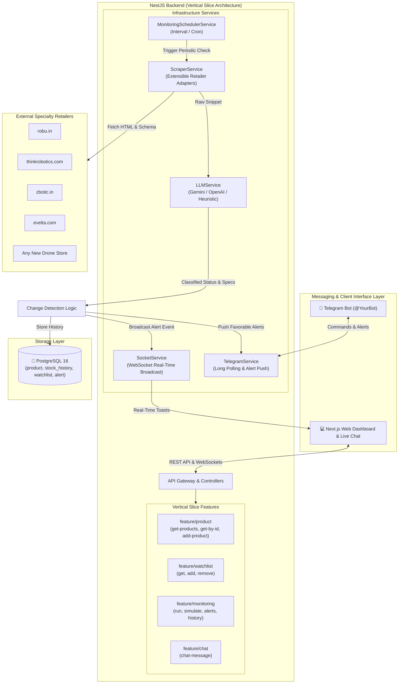

# 🚁 AeroHunt — AI-Powered Shopping Assistant for Drone Parts

[](https://nestjs.com/)
[](https://nextjs.org/)
[](https://www.postgresql.org/)
[](https://typeorm.io/)
[]()

An intelligent, lightweight systems-engineered assistant designed for Indian drone builders to track volatile electronics stock across specialty retailers (**Robu.in**, **ThinkRobotics**, **Zbotic**, **Evelta**), receive real-time alerts via **Telegram** & WebSockets, and interact through a conversational AI chat interface.

---

## 📑 Table of Contents
- [1. Architecture Overview](#1-architecture-overview)
- [2. System Design Decisions & Trade-offs](#2-system-design-decisions--trade-offs)
  - [2.1 Data Acquisition Layer](#21-data-acquisition-layer)
  - [2.2 LLM Usage — Where, Why & Model Choice](#22-llm-usage--where-why--model-choice)
  - [2.3 State & Change Detection Engine](#23-state--change-detection-engine)
  - [2.4 Messaging & Conversational Chat Interface](#24-messaging--conversational-chat-interface)
  - [2.5 Vertical Slice Architecture](#25-vertical-slice-architecture)
- [3. Target Retailers & Seed Watchlist](#3-target-retailers--seed-watchlist)
- [4. Environment Variables Configuration](#4-environment-variables-configuration)
- [5. Quick Start & Setup Guide](#5-quick-start--setup-guide)
  - [Option A: Docker Compose (Recommended)](#option-a-docker-compose-recommended)
  - [Option B: Local Development](#option-b-local-development)
  - [Database Migration & Seeding](#database-migration--seeding)
- [6. How to Add a New Retailer Store](#6-how-to-add-a-new-retailer-store)
- [7. Testing & Video Demo Guide](#7-testing--video-demo-guide)
- [8. Known Limitations & Production Considerations](#8-known-limitations--production-considerations)

---

## 1. Architecture Overview



---

## 2. System Design Decisions & Trade-offs

### 2.1 Data Acquisition Layer
- **Extensible Retailer Adapter Pattern**: Rather than writing brittle single-file scrapers, data acquisition is structured around the `RetailerScraperAdapter` interface:
  - `RobuScraperAdapter`: Tailored for WooCommerce schema, JSON-LD `@type: Product`, and inventory badge selectors (`.stock.in-stock`, `.out-of-stock`).
  - `ThinkRoboticsScraperAdapter`: Tailored for Shopify structures (`.product-form__submit`, `.badge--sold-out`, meta availability).
  - `ZboticScraperAdapter` & `EveltaScraperAdapter`: Specialized handlers for OpenCart / WooCommerce variations.
  - `GenericScraperAdapter`: Universal fallback capable of extracting Schema.org/Product JSON-LD, OpenGraph tags, and DOM heuristics from **any arbitrary e-commerce URL**.
- **Network Resilience**: Uses native Node.js `fetch` with browser User-Agent headers, configurable timeouts (`AbortSignal.timeout`), and graceful fallback so failures on one site never block monitoring of others.

### 2.2 LLM Usage — Where, Why & Model Choice
- **Where LLM is applied**:
  1. **Unstructured Page Classification**: E-commerce stores often embed ambiguous statuses (e.g. "Available on backorder", "Pre-order batch arriving Nov 20", "Temporarily out of stock"). The LLM cleans noisy HTML snippets into a strict schema: `IN_STOCK`, `OUT_OF_STOCK`, `PRE_ORDER`, `UNKNOWN` plus technical specifications.
  2. **Conversational Assistant**: Parses user intent (`SEARCH`, `FILTER`, `CHECK_STATUS`, `ADD_WATCHLIST`, `COMPARE`) from freeform questions.
- **Why a Lightweight Model**: Frontier models (GPT-4o, Claude Opus) are unnecessarily expensive and slow for periodic classification. We target lightweight models like **Google Gemini 1.5/2.0 Flash** or **OpenAI GPT-4o-mini**, which cost fractions of a cent per request with sub-second latencies.
- **Fail-safe Heuristic Engine**: If neither `GEMINI_API_KEY` nor `OPENAI_API_KEY` is provided, the system seamlessly activates its built-in rule-based classification and natural language parser. **Zero downtime, zero external dependencies required for initial boot and local testing.**

### 2.3 State & Change Detection Engine
- **State Model**: Tracks current state in `product` and records every transition in `stock_history` (`oldStatus` ➡️ `newStatus`, `oldPrice` ➡️ `newPrice`, and change reason).
- **Favorable Transition Filter**: Alerts fire only when a change is favorable to the user:
  - Transition from `OUT_OF_STOCK` to `IN_STOCK`
  - Opening of a `PRE_ORDER` listing
  - Significant price drops on tracked items
- **Audit Log**: Every dispatch is stored in `alert` table with timestamp, channel (`TELEGRAM`, `WEBSOCKET`), and status (`SENT`).

### 2.4 Messaging & Conversational Chat Interface
- **Telegram Bot**: Operates via HTTP long-polling (`getUpdates`), eliminating the need for public webhooks or ngrok tunnels during local development.
- **Unified Capability**: The same natural language capabilities are available both through **Telegram** and the **Next.js Web Chat**, ensuring full feature parity whether you are on mobile or desktop.

### 2.5 Vertical Slice Architecture
Following existing codebase conventions, features in `backend/src/feature/` are decoupled into independent vertical slices. Each slice encapsulates:
- `<action>.controller.ts`: API endpoint definition with route decorators
- `<action>.dto.ts`: Strict input validation and transformation (`class-validator`)
- `<action>.handler.ts`: Single-responsibility business logic
- `<action>.module.ts`: NestJS DI module for the slice

---

## 3. Target Retailers & Seed Watchlist

### Target Retailers (Extensible)
1. `robu.in`
2. `thinkrobotics.com`
3. `zbotic.in`
4. `evelta.com`

### Day-1 Seed Watchlist (Seeded automatically via `npm run seed`)
| Product Name | Retailer | Category | Seed Status | Price (INR) |
|---|---|---|---|---|
| **Raspberry Pi 5 8GB RAM Single Board Computer** | Robu.in | `raspberry_pi` | `IN_STOCK` | ₹7,499 |
| **Raspberry Pi 5 M.2 NVMe HAT+ Carrier Board** | ThinkRobotics | `hat` | `IN_STOCK` | ₹1,399 |
| **Holybro Pixhawk 6X Autopilot Standard Baseboard** | Robu.in | `flight_controller` | `OUT_OF_STOCK` | ₹36,999 |
| **Holybro Pixhawk 6X with PM02D Power Module** | Evelta | `flight_controller` | `PRE_ORDER` | ₹39,500 |
| **SpeedyBee F405 V4 55A BLS Flight Stack** | Zbotic | `flight_controller` | `IN_STOCK` | ₹5,499 |
| **Radxa Zero 3W Companion Computer 4GB RAM** | ThinkRobotics | `companion_computer` | `IN_STOCK` | ₹3,199 |
| **Waveshare PoE+ HAT for Raspberry Pi 5** | Robu.in | `hat` | `OUT_OF_STOCK` | ₹2,199 |

---

## 4. Environment Variables Configuration

Copy `.env.example` to `.env` in both folders:
```bash
cp backend/.env.example backend/.env
cp frontend/.env.example frontend/.env
```

### Backend (`backend/.env`)
| Variable | Description | Default / Example |
|---|---|---|
| `PORT` | Backend HTTP Port | `8090` |
| `DB_POSTGRES_HOST` | PostgreSQL Host (`localhost` for local, `database` for docker) | `localhost` / `database` |
| `DB_POSTGRES_PORT` | PostgreSQL Port | `5432` |
| `DB_POSTGRES_USERNAME` | Database username | `postgres` |
| `DB_POSTGRES_PASSWORD` | Database password | `123` |
| `DB_POSTGRES_DATABASE` | Database name | `db` |
| `GEMINI_API_KEY` | Google Gemini API Key *(Optional, heuristic fallback used if blank)* | `AIzaSy...` |
| `OPENAI_API_KEY` | OpenAI API Key *(Optional fallback)* | `sk-...` |
| `LLM_MODEL` | Lightweight LLM model | `gemini-1.5-flash` |
| `TELEGRAM_BOT_TOKEN` | Telegram Bot Token from @BotFather *(Optional)* | `123456:ABC-DEF...` |
| `MONITORING_CRON` | Cron schedule expression for periodic monitoring | `"0 0 * * *"` (Daily midnight) |

### Frontend (`frontend/.env`)
| Variable | Description | Default |
|---|---|---|
| `NEXT_PUBLIC_BACKEND_URL` | Backend URL for API calls & WebSocket | `http://localhost:8090` |

### Frontend Multi-Page Architecture
The frontend is structured into clean, modular pages and reusable components:
- `/`: **Parts Catalog & Overview** (search, multi-criteria filtering, product cards)
- `/watchlist`: **Dedicated Watchlist** (trackers, alert status, remove controls)
- `/chat`: **Conversational AI Assistant** (dedicated full-screen chat interface)
- `/monitoring`: **Monitoring & Audit Center** (manual run, simulated alerts, live dispatched alerts, stock/price change audit log)

---

## 5. Quick Start & Setup Guide

### Option A: Docker Compose (Recommended)

1. **Start backend infrastructure and database:**
   ```bash
   cd backend
   docker compose --env-file .env -f docker-compose.yml -f docker-compose.dev.yml up --build -d
   ```

2. **Execute Database Migrations & Seeds inside backend container:**
   ```bash
   docker compose exec backend sh
   npm run build && npm run migration:run && npm run seed
   exit
   ```

3. **Start frontend container:**
   ```bash
   cd ../frontend
   docker compose --env-file .env -f docker-compose.yml -f docker-compose.dev.yml up --build -d
   ```

4. **Access the application:**
   - Web App Dashboard: [http://localhost:3000](http://localhost:3000)
   - Backend API: [http://localhost:8090](http://localhost:8090)

---

### Option B: Local Development

1. **Start PostgreSQL database:**
   ```bash
   cd backend
   docker compose -f docker-compose.yml -f docker-compose.dev.yml up -d database
   ```

2. **Run migrations and seed day-1 data:**
   ```bash
   DB_POSTGRES_HOST=localhost npm run build
   DB_POSTGRES_HOST=localhost npm run migration:run
   DB_POSTGRES_HOST=localhost npm run seed
   ```

3. **Start backend server:**
   ```bash
   DB_POSTGRES_HOST=localhost npm run start:dev
   ```

4. **Start frontend:**
   ```bash
   cd ../frontend
   npm run dev
   ```

---

## 6. How to Add a New Retailer Store

The system is architected for zero-rewrite extensibility. To add a new electronics retailer (e.g. `droneshop.in`):

1. **Create an adapter** in `backend/src/infrastructure/service/scraper/`:
   ```ts
   // droneshop-scraper.adapter.ts
   import { RetailerScraperAdapter, ScrapedProductData } from './retailer-adapter.interface.js';

   export class DroneShopScraperAdapter implements RetailerScraperAdapter {
     readonly retailerName = 'droneshop.in';

     canHandle(url: string): boolean {
       return url.toLowerCase().includes('droneshop.in');
     }

     async extract(html: string, url: string): Promise<ScrapedProductData> {
       // Extract DOM selectors / JSON-LD
       return {
         title: 'Extracted Title',
         price: 12000,
         stockStatus: StockStatusEnum.IN_STOCK,
         retailer: 'droneshop.in' as any,
       };
     }
   }
   ```

2. **Register the adapter** in `ScraperService`:
   ```ts
   // scraper.service.ts
   this.registerAdapter(new DroneShopScraperAdapter());
   ```

3. **No further changes required!** The monitoring scheduler, LLM classifier, watchlist, and Telegram alerting will immediately handle the new domain.

---

## 7. Testing & Video Demo Guide

For take-home evaluation or recording your demo video:

### 1. Simulated Stock Transition (Immediate Alert Demo)
Trigger an instant `OUT_OF_STOCK` ➡️ `IN_STOCK` transition for the Holybro Pixhawk 6X:
```bash
curl -X POST http://localhost:8090/monitoring/simulate \
  -H "Content-Type: application/json" \
  -d '{"productUuid": "d0a80101-7b1d-4a9f-8c1a-000000000003", "targetStatus": "IN_STOCK"}'
```
- A push notification will be sent to your configured Telegram channel.
- A live green alert toast will pop up immediately on the Next.js Web UI via WebSockets.
- The change is audited in the **Activity & Alerts Log** tab.

### 2. Trigger Full Daily Monitoring Cycle On Demand
```bash
curl -X POST http://localhost:8090/monitoring/run
```
- Scrapes all tracked products across Robu, ThinkRobotics, Zbotic, and Evelta.
- Classifies listings with LLM and updates changes.

### 3. Conversational AI Chat Interaction
Test natural search and watchlist additions:
```bash
# Filter products under budget
curl -X POST http://localhost:8090/chat \
  -H "Content-Type: application/json" \
  -d '{"message": "Find flight controllers in stock under 10000"}'

# Add URL to watchlist conversationally
curl -X POST http://localhost:8090/chat \
  -H "Content-Type: application/json" \
  -d '{"message": "Track https://robu.in/product/raspberry-pi-5-8gb/"}'
```

### 4. Running Backend Unit Tests
```bash
cd backend && npm test
```

---

## 8. Known Limitations & Production Considerations

1. **Cloudflare / Anti-Bot Protection**: Specialty retailers using aggressive Cloudflare Turnstile or Akamai challenges may require headless browser rendering (e.g. Playwright / Puppeteer with stealth plugin) or proxy rotation in production.
2. **Rate Limiting & Polling Courtesy**: To avoid IP banning, scrapers include realistic User-Agent headers, but a production setup should introduce exponential backoff and randomized delays between requests.
3. **Multi-Tenancy**: The current database tracks user watchlists keyed by `userId` (supporting web users or Telegram Chat IDs). Future expansion can add Telegram OAuth verification.

---

Made with 🚁 for Indian Drone Builders.
